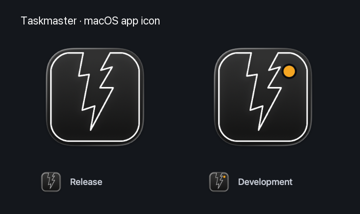

# macOS app icons

`../TaskmasterIcon.icon` is the editable Icon Composer source: a black background and
the original white lightning outline connected to its rounded frame. The mark
preserves the path, stroke width, caps and joins from
`docs/src/images/taskmaster-logo.svg` at the repository root. Its SVG canvas adds a
small inset to keep the frame clear of Apple's enclosure. Apple supplies the
material highlights, lighting and appearance variants.



`../DevIndicator.svg` adds the amber development marker. The generator derives
the development document from the release document so their artwork stays in
sync.

To regenerate with Xcode 26 or newer selected by `xcode-select`, run from `taskmaster/`:

```sh
./scripts/make-icon.sh
```

Commit both catalogs in this directory and `../icon.icns` / `../dev-icon.icns`
together with artwork changes. These compiled resources are checked in so
ordinary builds do not need Icon Composer or a newer Xcode.

`scripts/install-icon.sh` installs the appropriate `Assets.car` and ICNS family
in release and development bundles before signing. `CFBundleIconName` selects
the layered icon on macOS 26 and newer; `CFBundleIconFile` supplies the matching
fallback for older macOS releases and tools that read ICNS. The catalog also
contains the compiler's raster renditions for the macOS 15 deployment target.

For inspecting the generated documents and raster sizes, retain the temporary
workspace:

```sh
TASKMASTER_KEEP_ICON_WORK_DIR=1 ./scripts/make-icon.sh
```
